# FaithGuard system architecture

This document explains how FaithGuard is built: first the whole system, then every component on its own, each with a diagram and a step-by-step explanation. It describes the system **as it is implemented** in `src/faithguard/` (decision numbers such as D-084 point to [decision-log.md](decision-log.md), where each choice is recorded with its reason).

Diagrams are written in Mermaid, so they render on GitHub and in most Markdown viewers.

**Contents**

1. [What FaithGuard does](#1-what-faithguard-does)
2. [The whole system](#2-the-whole-system)
3. [Shared foundation: records, gold store and splits](#3-shared-foundation-records-gold-store-and-splits)
4. [Reading numbers and claims](#4-reading-numbers-and-claims)
5. [Detection](#5-detection)
6. [Decision policy](#6-decision-policy)
7. [Repair](#7-repair)
8. [Benchmark and data pipeline](#8-benchmark-and-data-pipeline)
9. [Controlled track and error injector](#9-controlled-track-and-error-injector)
10. [Answer generation](#10-answer-generation)
11. [Replay harness](#11-replay-harness)
12. [Labelling](#12-labelling)
13. [Evaluation and statistics](#13-evaluation-and-statistics)
14. [Training and GPU workflow](#14-training-and-gpu-workflow)
15. [A worked example, end to end](#15-a-worked-example-end-to-end)
16. [Code map](#16-code-map)
17. [Design rules that hold everywhere](#17-design-rules-that-hold-everywhere)

---

## 1. What FaithGuard does

An AI model answers a question about a company's annual report. Before the answer reaches the user, FaithGuard checks every number in it against the report's tables and then does one of three things:

| Action | When | What the user gets |
| --- | --- | --- |
| **Send** | The answer is very likely correct | The original answer, unchanged |
| **Repair** | The answer is likely wrong, but the evidence holds the right values | A corrected answer, every changed number traced to a table cell |
| **Abstain** | It cannot be made safe | No answer; the evidence and a reason instead |

The goal is measurable: among answers that are sent, at most 10% may be wrong (α = 0.10), and this is *certified* on held-out data, counting errors that repair itself introduces.

The project has three research components, one per member, plus a shared benchmark:

| Component | Owner | Question it answers |
| --- | --- | --- |
| Detection | M.L Ahamed | Which parts of the answer are wrong, and why? |
| Decision policy | Sharaf | Should this answer be sent, repaired or withheld? |
| Repair | M.S.A Ahamed | How can the wrong numbers be fixed without breaking anything else? |
| Benchmark | All three | Real answers about US and Sri Lankan reports, labelled by separate blind Claude passes (D-103, D-105) |

---

## 2. The whole system

FaithGuard has two halves that share one record format:

- the **online path**, which checks one answer at a time (what a user would run);
- the **offline side**, which builds the data, trains the learned parts, certifies the policy and evaluates everything.

### 2.1 Overview

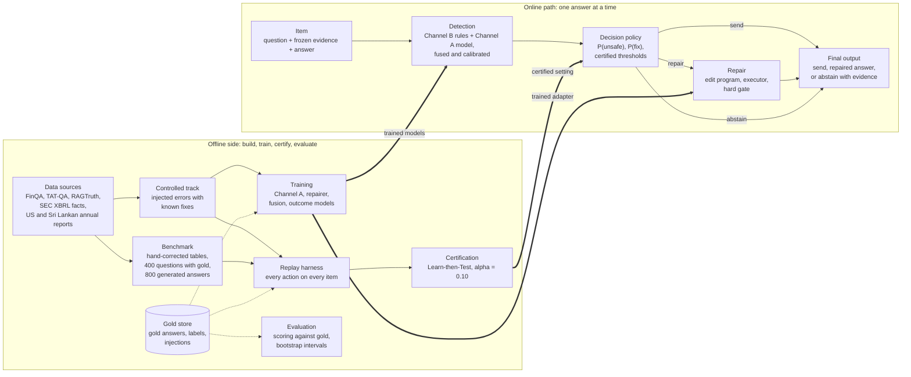

The dotted arrows show the most important rule in the design: **only the offline side may read the gold store.** Detection, the policy and repair never see a gold answer or a label while deciding; a test (`tests/test_labelling_splits_separation.py`) fails the build if they import it.

### 2.2 The online path in detail

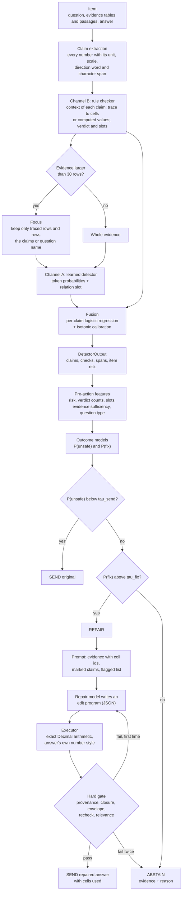

Step by step:

1. **Item.** Everything starts from one `Item`: the question, the *frozen* evidence (tables of typed cells and any text passages) and one answer. Evidence is frozen so that every method sees exactly the same text for the same question.
2. **Claim extraction.** The answer is scanned for numbers. Each becomes a `Claim` with its exact character span, kind (amount, percent, ratio, number), value in base units, printed style, and any direction word ("rose", "fell") that goes with it.
3. **Channel B** works out what each claim is about (metric, entity, period) and tries to trace it to the evidence. It returns a verdict per claim (supported, unsupported, unverifiable), the failing *slots* (which part of the context is wrong), the cells it traced to, and the cell expression that would give the correct value (`fix`).
4. **Focusing.** Annual-report statements have 40–80 rows. If the evidence has more than 30 rows, the learned parts see only the rows that matter (section 5.6). Small evidence is shown whole.
5. **Channel A** reads the question, the (focused) evidence and the answer, and gives every answer token a probability of being unsupported, plus the relation slot it most likely violates.
6. **Fusion** combines both channels claim by claim into a calibrated probability that the claim is wrong; the answer's risk is the chance that at least one claim is wrong.
7. **Policy.** Pre-action features (things known before acting) go into two outcome models. The certified thresholds turn their two probabilities into one action.
8. **Repair** (only if chosen). A small language model writes an *edit program* for the flagged claims. The executor applies it; the hard gate checks the result. One retry with the failure reason; a second failure means abstain.
9. **Final output.** A `FinalOutput` records the action, the text the user sees (none when abstaining), the reason, and the evidence cells behind every number.

`faithguard.pipeline.run(item, detector, policy, repairer)` wires these stages together. Each stage is a plain function or object, so the rule-only versions (detector v0 = Channel B, policy v0 = threshold, repairer v0 = rules) and the trained versions are interchangeable without changing the pipeline.

### 2.3 The offline side in detail

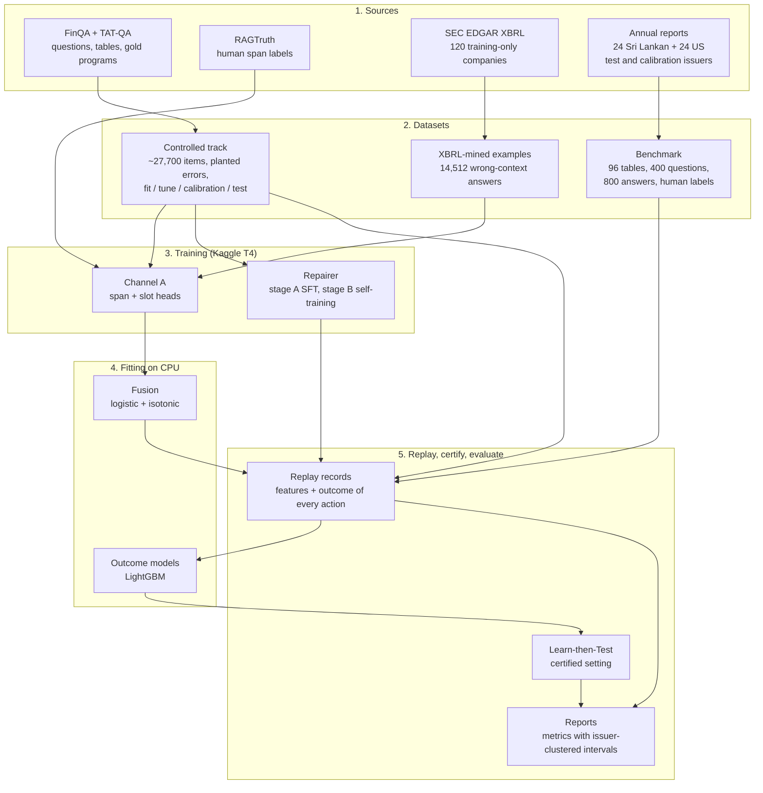

1. **Sources** are turned into two kinds of data. The *controlled track* plants known errors in template answers to FinQA and TAT-QA questions, so every outcome can be scored automatically and in bulk. The *benchmark* holds natural answers to real questions about current annual reports, labelled by separate blind Claude passes in the roles the plan gave to people (D-103, D-105); it is what every paper's claims rest on.
2. **Training** happens on free Kaggle T4 GPUs: Channel A learns from controlled-track spans, RAGTruth and XBRL-mined examples; the repairer learns from controlled-track edit programs.
3. **Fitting** of the small models (fusion, outcome models) runs on a laptop CPU.
4. **Replay** plays out every action on every item and stores what each would have produced. The outcome models are fitted on these records, the policy is certified on them, and the papers' metrics are computed from them.

### 2.4 The layers

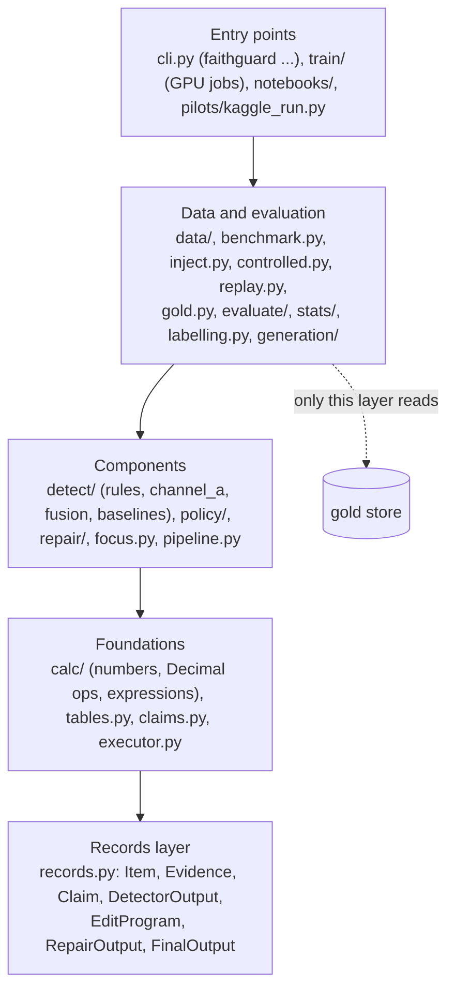

Each layer uses only the layers below it. The gold store sits beside the data and evaluation layer, out of reach of the components.

---

## 3. Shared foundation: records, gold store and splits

### 3.1 The record format

Every component reads and writes the same Pydantic records (`records.py`, format v1). They are versioned, validated and stored as JSON Lines.

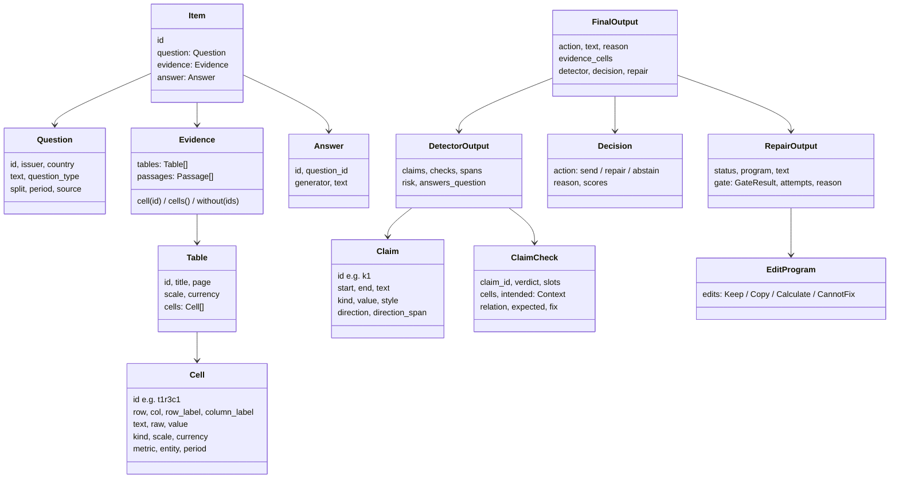

Key points:

- **Cells carry their context.** When a table is parsed (`tables.py`), every cell gets a `metric` (normalised row label), `entity` (Group, Company, Bank, from the column headers), `period` (year), `scale` (power of ten: 3 for thousands) and `currency`. Its `value` is in base units (rupees, dollars), so "14,212,560" in a Rs. '000 table becomes 14,212,560,000. `raw` keeps the printed number.
- **Cell ids are positional**: `t1r3c1` is table 1, row 3, column 1. Questions' gold answers, the checker's fixes and repair programs all refer to cells by these ids.
- **Every downstream record points back to the item by id**, so outputs from different runs can be joined.

### 3.2 The gold store

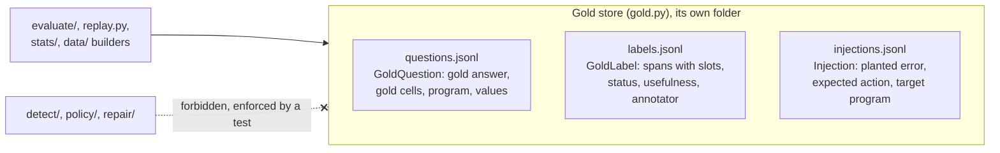

The gold store holds everything that would let a component cheat: gold answers, human labels, and for controlled items the planted error and its fix. It lives in a separate folder and module. Training-data builders (`data/repair_examples.py`, `data/channel_a_examples.py`) may read it because they run offline (D-034); the decision-time packages may not.

A rebuild of the benchmark replaces only the gold answers and keeps labels and injections (a lesson from D-067, when a rebuild once emptied the labels).

### 3.3 Splits

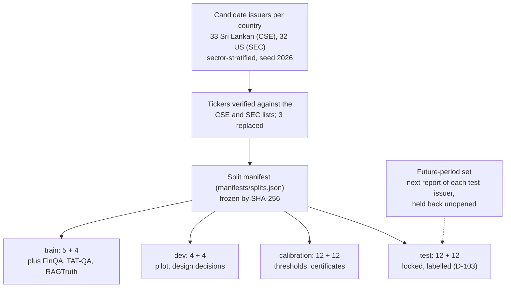

Rules the manifest enforces (`splits.py`): a company appears in exactly one split; no FinQA company may be a test or calibration issuer (so training data never shares a company with the test); pilot questions come only from development issuers. The controlled track has its own issuer-disjoint split by a stable hash of the issuer: fit 50%, tune 10%, calibration 20%, test 20% (D-023).

---

## 4. Reading numbers and claims

Every component reads numbers the same way, through `calc/numbers.py` and `claims.py`. If the checker, the repairer and the scorer read an answer differently, their results would disagree for reasons that have nothing to do with the research questions.

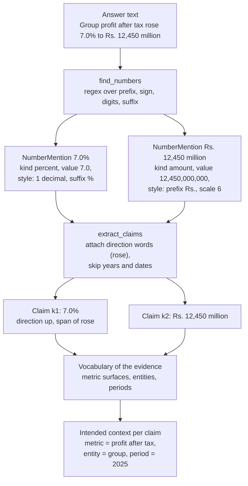

What the number reader handles:

| Convention | Example | Read as |
| --- | --- | --- |
| Currency prefixes and words | "Rs.", "LKR", "US$", "$", "rupees" | currency code |
| Scale words and units | "thousand", "million", "bn", "Rs. '000", "Rs. ‘000" | scale (3, 6, 9) |
| Percent forms | "%", "per cent", "pp", "bps" | percent (bps converted) |
| Ratios | "1.74x", "1.74 times" | ratio |
| Negatives in tables | "(2,104,330)" | minus |
| Negative percentages in prose | "(3)%" | minus 3% (D-094) |
| Years and day-of-month | "2025", "31 March" | skipped as claims |

Each mention keeps its **printed style** (prefix, suffix, scale, decimals, grouping, brackets). That style is reused when a repair writes a new number, so a corrected figure looks exactly like the one it replaces.

**Matching rule.** A printed number matches a value if the value rounds to it at the printed precision (`matches`): "Rs. 14.2 billion" matches 14,212,560,000; "9.3%" matches 9.2922%; "9.30%" does not.

**Context.** `claims.py` builds a `Vocabulary` from the evidence: every metric's surface forms (row labels and their normalised variants), the entities in the column headers, and the periods. For each claim it looks at the words around the number and the question to decide the *intended* metric, entity and period. This is what lets the checker say "this is the Bank's figure, but the claim is about the Group".

**Exact arithmetic.** `calc/ops.py` implements growth, share, ratio, difference, sum and average with Python's `Decimal`, raising an error rather than returning a misleading number (for example, growth from a zero base). `calc/expr.py` parses expressions such as `growth(t1r3c1, t1r3c2)` into a tree and evaluates it; nothing is ever passed to `eval`, so an expression cannot run arbitrary code.

---

## 5. Detection

Detection answers: which spans of the answer are unsupported, which part of their context is wrong, and how risky is the whole answer?

### 5.1 Overview

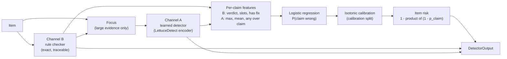

The two channels are complementary. Channel B is exact and explains itself (it names the cell and the failing slot) but only covers numbers its rules understand. Channel A generalises across phrasing and can flag non-numeric claims, but it is a statistical model. Fusion lets each cover the other's weak spots, and calibration turns the result into a probability the policy can use.

### 5.2 Channel B: the rule checker

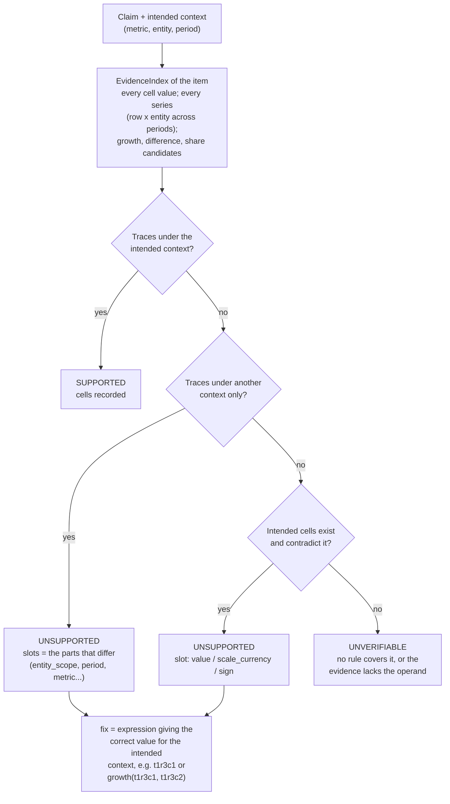

How it works:

1. **Index the evidence.** For each item, `EvidenceIndex` lists every numeric cell and every *series* (one table row for one entity across periods). From each series it precomputes the changes between consecutive periods: differences and growth rates. Shares and ratios between cells are candidates too.
2. **Trace each claim.** An amount is compared with cells; a percentage with growth rates, shares and printed percentage cells; a difference with differences. Comparison uses the printed precision of the claim.
3. **Name the slots.** If the number only matches a cell whose context differs from the intended one, every differing part becomes a slot: another entity is `entity_scope`, another year is `period`, another line item is `metric`. Right digits with the wrong unit word is `scale_currency`; a direction word that disagrees with the sign is `sign`; a growth computed on the wrong base is `basis`; a needed cell absent from the evidence is `missing_operand`.
4. **Record the fix.** For the intended context, the checker records the expression that gives the correct value. The policy uses whether such fixes exist (*evidence sufficiency*), and the rule-only repairer uses them directly.
5. **Relevance.** The checker also records whether the answer addresses the question (`answers_question`), which the gate later uses.

Text-only numbers count only weakly: a number found only in a text passage that does not name the intended metric is "unverifiable", not "supported" (D-017). When a metric appears in several rows with different values, the checker uses the row the answer's other numbers came from (D-019).

### 5.3 Channel A: the learned detector

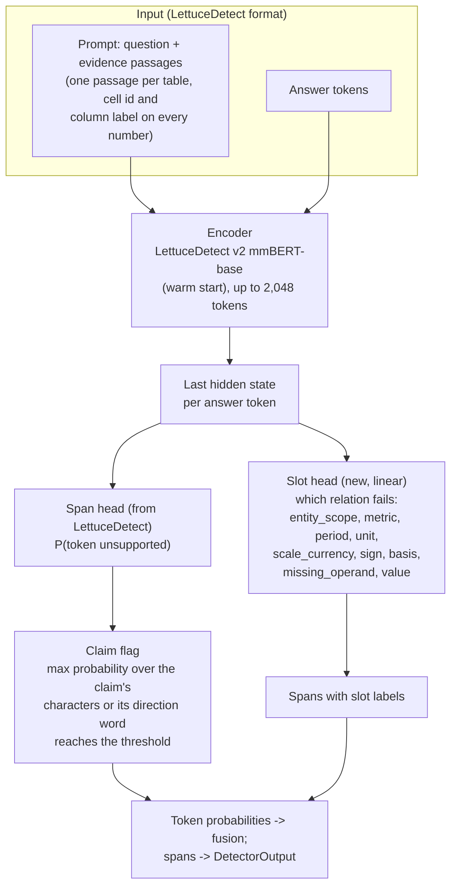

- **Architecture.** One encoder with two heads. The span head is LettuceDetect's token classifier (supported or not). The slot head is a linear layer on the last hidden state; its loss (on tokens inside gold spans only) is added to the span loss with weight 0.5 (D-030).
- **Warm start.** LettuceDetect v2 mmBERT-base was chosen over v1-large in the phase-1 pilot: 1.8 to 2.0 times faster and lighter on a T4, with nothing favouring the larger model (D-054).
- **Labels** are on answer tokens only, so the model learns to judge the answer against the evidence, not to read the evidence.

Training data (34,229 examples, D-075):

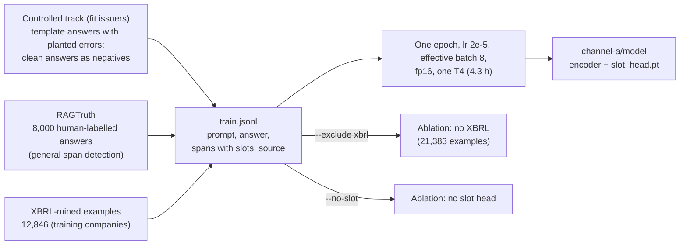

### 5.4 XBRL mining (wrong-context supervision)

US companies file their statements in XBRL, where every fact carries a concept, a period, a unit and dimensional context. That makes realistic wrong-context errors free to generate.

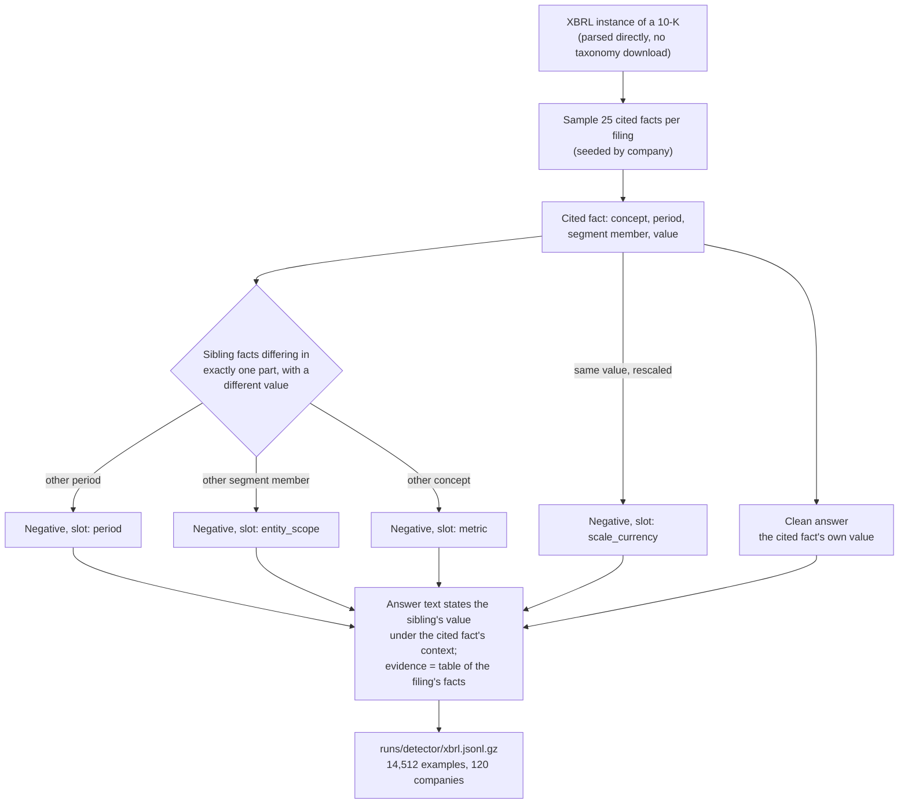

The negative answer states a number that really is in the filing, but under the wrong context: exactly the "right number, wrong context" error. Because the sibling differs in one known part, the label (the slot) is exact. Facts come only from FinQA's companies, which are training-only; no benchmark issuer is ever mined (D-032). One company in ten goes to development. Counts: 3,000 clean, 5,100 metric, 3,000 scale, 1,995 entity scope, 1,417 period (D-049).

### 5.5 Fusion and calibration

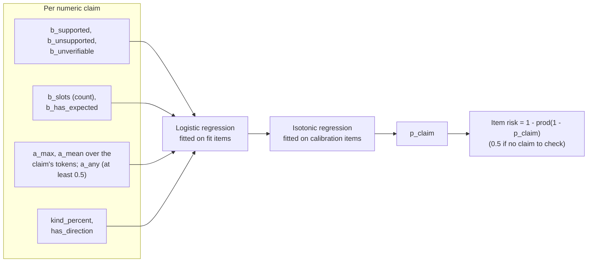

The item risk is the chance that at least one claim is wrong, treating claims as independent. It feeds the policy as a feature and is what the calibrated detector-threshold baseline thresholds. The fusion study (`train/fusion_study.py`) fits and compares "B only", "A only" and "A + B" on a hash split of development items.

### 5.6 Focusing large evidence

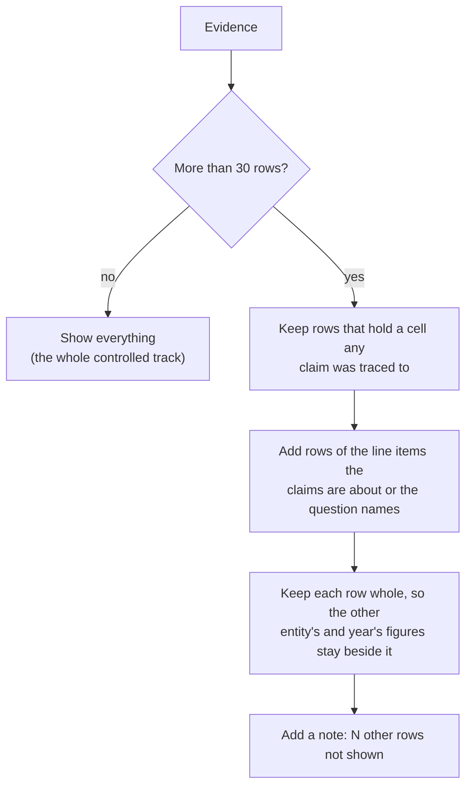

Annual-report statements made repair prompts about four times longer than the 2,048 tokens the repairer was trained on, and ran a T4 out of memory (D-084). Focusing uses only the rule checker's traces and the question, never gold. Channel A, the repairer **and the released baseline detectors** all see the same focused evidence (D-091), so comparisons are about the systems, not about how much text each was given.

### 5.7 Baseline detectors

| Detector | How its risk is defined |
| --- | --- |
| LettuceDetect v1-large, v2 mmBERT | Highest span confidence |
| HHEM-2.1-Open | 1 − consistency score |
| Granite Guardian 4.1-8B (4-bit) | 1 if its groundedness verdict is "yes" (no thinking) |

All run through `detect/baselines.py` on the same evidence text (`passages()`), on controlled items (`train/baseline_eval.py`) or on benchmark items without reading gold (`--items`).

---

## 6. Decision policy

The policy decides, for each answer, whether to send it, repair it or withhold it, so that at most α = 10% of sent answers are wrong, *with high probability*, while as many correct, useful answers as possible get through.

### 6.1 Overview

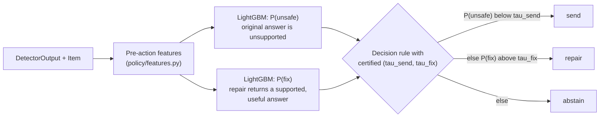

**Features** (pre-action only: nothing from gold, nothing from a repair attempt): the detector's risk; numbers of claims, supported, unsupported and unverifiable claims; evidence links; missing operands; *evidence sufficiency* (every failing claim has a correct value in the evidence); whether the answer addresses the question; evidence size; percentage and directional claims; Channel A's highest span score; counts of each failing slot; and the question type.

**Outcome models.** Two LightGBM classifiers trained on replay records of the fit split. The one challenger is a neural outcome model (D-096, `policy/neural.py`): Channel A's v2 mmBERT encoder fine-tuned on a GPU with one output each for P(unsafe) and P(fix), reading the question, the focused evidence, the answer and the same features written as text. It trains on the fit split with early stopping on tune, and the study reads back the probabilities it wrote and certifies them on the same grid.

### 6.2 Policy families

| Family | Rule | Grid (pre-registered) |
| --- | --- | --- |
| Outcome-aware (the method) | send if P(unsafe) < τ1; else repair if P(fix) > τ2; else abstain | τ1 ∈ {0.005 … 0.5} (8) × τ2 ∈ {0.5 … 0.99} (7) = 56 settings |
| Verified only (detector threshold) | send if risk < t; else abstain | t ∈ {0.25, 0.75, 1.01} |
| Threshold v0 | as above, but repair when the evidence holds every correct value | t ∈ {0.25, 0.75, 1.01} |
| Static four-state | clean → send, fixable → repair, else abstain, above a confidence | 0.5 to 0.95 |
| Send all / repair all | fixed strategies | – |
| Oracle | best action per item from stored outcomes | upper bound only |

### 6.3 Certification (Learn-then-Test)

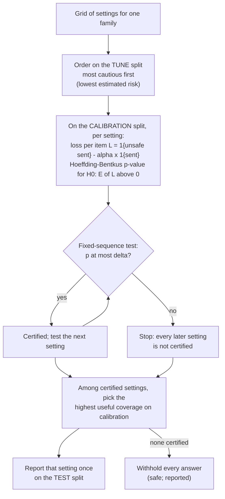

- **Why the linearised loss?** The target is a ratio, wrong sent ÷ sent ≤ α. Rewriting it as the per-item loss `1{unsafe sent} − α·1{sent}` with expectation ≤ 0 turns it into a mean that a concentration bound can certify. An answer that *repair made wrong* counts exactly like an original that was wrong.
- **Why order on a separate split?** Because the order does not depend on the calibration data, every certified setting holds its guarantee at the same time, so choosing the best of them is allowed.
- **Settings:** α = 0.10, δ = 0.05 (so the guarantee holds with 95% probability).
- **Issuer-level check:** the chosen setting is recertified treating each issuer as one draw, since answers about the same company are related (risk R-14).
- **Label budget:** with zero errors, 29 sent answers are the exact minimum for α = 0.10; the linearised Hoeffding–Bentkus certificate needs 32 (D-021). The study also reports, for random calibration subsets of growing size, how often a setting certifies.
- **Comparator:** SCoRE (`score-select`), which decides send or abstain with a guarantee on *expected* risk rather than a high-probability bound.

The certified model and thresholds are saved as a bundle and loaded by `policy/deployed.py` for use in `pipeline.run`.

### 6.4 Transfer study (when the repairer changes)

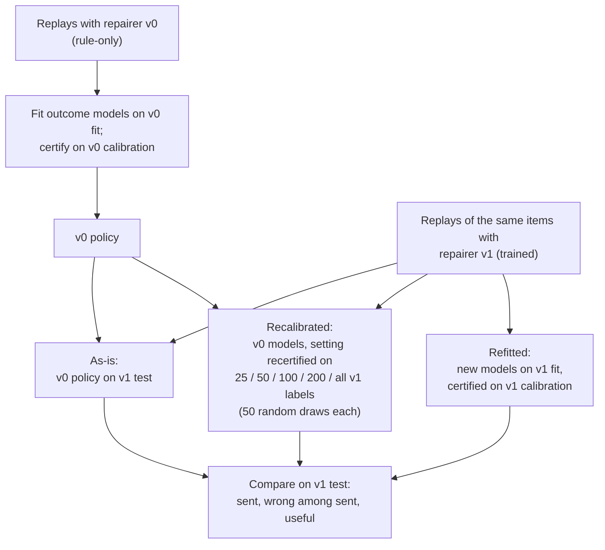

A certificate covers the outcomes it was computed on. When the repairer is upgraded, P(fix) and the outcomes of "repair" change, so the old certificate no longer applies. The study measures whether the old policy is still safe, how many new labels recalibration needs, and when only refitting helps. On the controlled-track rehearsal (4,000 replays with the trained repairer), the old policy stayed safe as it was (D-093). `faithguard transfer --v1 replay.jsonl` runs it on a laptop; `train/replays.py` produces v1's replays on a GPU.

---

## 7. Repair

Repair fixes wrong numbers by having a small model write an **edit program** that a deterministic executor runs. The model never writes a number itself.

### 7.1 Overview

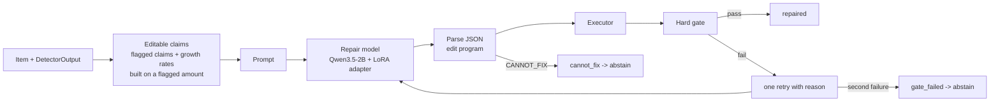

### 7.2 The edit language

| Operation | Example | Meaning |
| --- | --- | --- |
| KEEP | `{"op":"KEEP","claim":"k1"}` | The claim is right as written (rejects a false flag) |
| COPY | `{"op":"COPY","claim":"k2","cell":"t1r3c1"}` | Replace the number with a cell's value |
| CALCULATE | `{"op":"CALCULATE","claim":"k1","expr":"growth(t1r3c1, t1r3c2)"}` | Replace it with a calculation on cells |
| CANNOT_FIX | `{"op":"CANNOT_FIX","reason":"missing_operand","claim":"k2"}` | The evidence lacks what is needed |

Expressions may use cell ids, decimal literals, `+ - * /`, brackets and the functions `growth`, `share`, `ratio`, `diff`, `sum`, `avg`, `abs`. Reason codes: missing_operand, ambiguous_evidence, non_numeric, conflicting_evidence.

### 7.3 The prompt

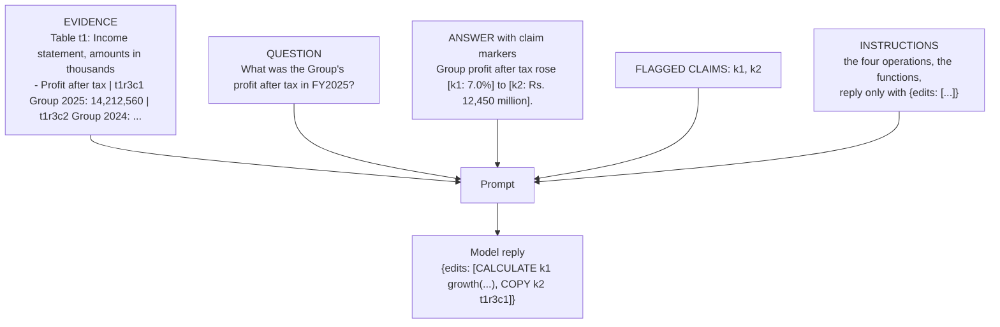

The evidence is shown with a cell id and column label on every number, so the model can name cells. Large statements are focused (section 5.6). The same prompt format is used in training and at inference (D-028).

### 7.4 Executor

```mermaid
flowchart TD
    P["Edit program"] --> V1{"Every claim known,<br/>none edited twice?"}
    V1 -->|no| ER["ExecError -> retry"]
    V1 -->|yes| L["For each COPY / CALCULATE"]
    L --> C1{"COPY: percent cell into a<br/>non-percent claim, or reverse?"}
    C1 -->|yes| ER
    L --> C2{"CALCULATE: uses at least<br/>one evidence cell?"}
    C2 -->|no| ER
    L --> C3{"CALCULATE: function gives the<br/>right kind (growth/share give %)?"}
    C3 -->|no| ER
    C1 -->|no| VAL["Value from the cell<br/>(base units, or printed units<br/>for bare numbers)"]
    C2 -->|yes| EV["Evaluate the expression<br/>with Decimal"]
    C3 -->|yes| EV
    EV --> DIR{"Claim has a direction word<br/>whose sense disagrees with the sign?"}
    VAL --> REN
    DIR -->|yes| FLIP["Swap the word<br/>(rose <-> fell), show |value|"]
    DIR -->|no| REN["Render in the claim's printed style<br/>prefix, scale word, decimals, brackets"]
    FLIP --> REN
    REN --> OV{"Edits overlap?"}
    OV -->|yes| ER
    OV -->|no| RES["ExecResult<br/>new text, changes, replacements"]
```

The executor makes repair deterministic: given the same program and item, it always writes the same text. It only ever replaces claim spans and their direction words. Rendering in the original style means "Rs. 12,450 million" becomes "Rs. 14,213 million", not "14212560000".

### 7.5 The hard gate

```mermaid
flowchart TD
    R["ExecResult + program"] --> P["Provenance<br/>each copied cell and each operand<br/>has the claim's intended metric and entity;<br/>period too for copies, shares and ratios;<br/>a share or ratio may use a line item<br/>the question names"]
    P --> C["Closure<br/>growth rates built on a changed<br/>amount were recomputed"]
    C --> E["Envelope<br/>nothing outside the edited claims<br/>and their direction words changed"]
    E --> K["Recheck<br/>Channel B supports every claim<br/>in the repaired answer"]
    K --> V["Relevance<br/>the repaired answer still<br/>answers the question"]
    V --> D{"All passed?"}
    D -->|yes| OK["Release the repaired answer"]
    D -->|no| F["Failures listed, e.g.<br/>provenance: k2 uses t1r3c3 (entity_scope)"]
```

Each check closes a specific way a repair can go wrong: copying the right-looking number from the wrong place (provenance), fixing an amount but leaving the growth rate built on it stale (closure), quietly changing other text (envelope), producing a number the evidence does not support (recheck), and answering a different question (relevance). The failure messages are fed back to the model for its one retry.

### 7.6 The model repairer loop

```mermaid
sequenceDiagram
    participant P as Pipeline
    participant R as ModelRepairer
    participant M as Repair model
    participant X as Executor
    participant G as Gate
    P->>R: item, detector output
    R->>R: editable claims; none -> nothing_to_fix
    R->>M: prompt
    M-->>R: reply
    R->>R: parse program (fenced JSON, first object, bare list)
    alt CANNOT_FIX
        R-->>P: cannot_fix (abstain)
    else edits an unflagged claim, or unparsable
        R->>M: prompt + "rejected: reason"
    else
        R->>X: execute
        X-->>R: result or ExecError
        R->>G: gate
        G-->>R: passed or failures
        alt passed
            R-->>P: repaired text, program, gate result
        else failed (first attempt)
            R->>M: prompt + "failed the checks: reasons"
        end
    end
    R-->>P: gate_failed after two attempts (abstain)
```

### 7.7 Three repairers behind one interface

| Repairer | How it writes the program | Role |
| --- | --- | --- |
| v0, rules (`repair/rules.py`) | From Channel B's `fix` for each unsupported claim, plus closure; claims with no fix get CANNOT_FIX | Baseline: what rules alone fix; v0 of the transfer study |
| Model (`repair/model.py`) | A language model writes it (trained adapter, zero-shot, or a llama.cpp server) | The method |
| Free rewrite (`repair/rewrite.py`) | The model rewrites the whole answer; no executor, no gate | The main baseline (RQ1) |

All return the same `RepairOutput`, so evaluation and replay treat them alike.

### 7.8 Training the repairer

```mermaid
flowchart TD
    CT["Controlled-track items, fit issuers"] --> DET["Channel B decides the editable<br/>claims, as in deployment"]
    DET --> T["Target = gold program restricted<br/>to editable claims"]
    T --> T1["flagged + gold edits it -> COPY / CALCULATE"]
    T --> T2["flagged + gold leaves it -> KEEP<br/>(30% of items get one correct claim<br/>flagged on purpose)"]
    T --> T3["needed cell removed -> CANNOT_FIX"]
    T --> T4["wrong claim not flagged -> item skipped<br/>(the envelope would forbid the fix)"]
    HO["basis errors held out entirely (RQ2)"] -.-> T
    AS["v1 only: arithmetic slips<br/>(1,133 repair-only examples)"] --> SFT
    T1 --> SFT["Stage A: supervised fine-tuning<br/>Qwen3.5-2B, LoRA r = 16, 1 epoch,<br/>lr 2e-4, 2,048 tokens, fp16, one T4"]
    T2 --> SFT
    T3 --> SFT
    SFT --> AD["adapter (stage A)"]
    AD --> SB["Stage B, per round:<br/>sample 4 programs per item;<br/>keep the first the executor + gate accept<br/>(no gold); fine-tune on kept programs<br/>+ half as many stage A examples"]
    SB --> AD2["adapter after 2 rounds"]
```

- **Why KEEP items?** A learned detector will sometimes flag a correct claim. Training on deliberately false flags teaches the model to leave them alone (RQ3).
- **Why hold out basis errors?** To test repair on an error type never seen in training (RQ2).
- **Why mix stage A data into stage B?** An abstention (CANNOT_FIX) cannot be verified without gold, so self-training alone would make the model forget how to decline (D-029).
- **Arithmetic slips** (repairer v1, D-088): a growth rate or share computed from the right figures but misstated in its last digits, the commonest error in the pilot's natural answers. They are built outside the controlled track (`controlled.repair_only`), so nothing else changes.

---

## 8. Benchmark and data pipeline

```mermaid
flowchart TD
    M["Manifests<br/>lk-reports.csv, us-reports.csv"] --> DL["faithguard reports download<br/>CSE PDFs, SEC 10-K HTML;<br/>size and SHA-256 recorded"]
    DL --> DR["Draft tables<br/>LK: data/pdf_tables (words by position)<br/>US: data/html_tables (the filing's own tables)"]
    DR --> HC["Hand correction, cell by cell<br/>CSV exactly as printed"]
    HC --> CK["Totals check<br/>every Total row = rows above it<br/>(rounding allowance)"]
    CK --> Y["Report YAML + table CSVs<br/>data/benchmark/country/ISSUER/year"]
    Y --> QW["Questions: text, type,<br/>gold cell expression, expect, author"]
    QW --> BC["faithguard benchmark check<br/>recompute gold from cells,<br/>compare with expect"]
    BC --> BB["faithguard benchmark build<br/>questions.jsonl (frozen evidence)<br/>+ gold store"]
    BB --> GEN["Answer generation (section 10)"]
    GEN --> IT["faithguard items<br/>join questions + answers -> items.jsonl"]
    IT --> LAB["Labelling (section 12)"]
    Y --> AUTO["Automatic extraction<br/>(PyMuPDF text, uncorrected)<br/>real-world condition"]
```

- **Two statements per report:** income statement (t1) and statement of financial position or balance sheet (t2): 96 tables for 48 reports. Every one passes the totals check.
- **Questions:** 400 groups, 250 Sri Lankan and 150 US, each with a gold answer as a cell expression (`growth(t1r3c1, t1r3c2)`) and the value as the author read it (`expect`). Code recomputes and compares the two, so a wrong cell or a misread figure is caught before labelling (D-035).
- **Traps:** questions are written to invite wrong-context errors: Group versus Company or Bank, prior-year columns, repeated line items, scale mismatches, falls stated as changes, January fiscal years.
- **Privacy:** benchmark content stays out of the public repository until the test set is locked (D-036).
- **Real-world condition:** the Sri Lankan evidence is also read by an automatic extractor without correction (PyMuPDF text, 94.2% of figures placed correctly on the 48 tables, D-070), to measure how table-reading errors change FaithGuard's decisions.

---

## 9. Controlled track and error injector

```mermaid
flowchart TD
    S["FinQA / TAT-QA example<br/>question, table, gold program"] --> G["Recompute the gold value from the<br/>converted program; keep only if it<br/>reproduces the dataset's answer"]
    G --> SH{"Shape the templates can express?<br/>lookup, difference, growth, share"}
    SH -->|no| DROP["dropped"]
    SH -->|yes| COR["Correct answer from a template<br/>(variant chosen with a fixed seed)"]
    COR --> E0["none: the correct answer<br/>expected action: send"]
    COR --> E1["period / metric / entity:<br/>a sibling cell's value<br/>expected: repair"]
    COR --> E2["scale: right digits, wrong unit word"]
    COR --> E3["sign: direction word reversed"]
    COR --> E4["basis: growth on the wrong base"]
    COR --> E5["missing_operand: wrong figure and the<br/>needed cell removed; expected: abstain"]
    E1 --> TP["Target program: the edits that fix<br/>exactly the wrong numbers"]
    E2 --> TP
    E3 --> TP
    E4 --> TP
    E5 --> CF["Target: CANNOT_FIX"]
    TP --> ST["Item + Injection<br/>(gold store)"]
    CF --> ST
    E0 --> ST
    ST --> SP["Track split by issuer hash<br/>fit 50 / tune 10 / calibration 20 / test 20"]
    SP --> RP["Replay (section 11), cached in<br/>runs/controlled/source-split/"]
```

The controlled track exists so that every component can be developed and every outcome scored automatically, long before people label the benchmark. Errors propagate the way real ones do: a wrong amount changes the growth rate computed from it. Every item records the action it should receive (send, repair or abstain). Its limitation is that answers are written from templates; the papers' claims therefore rest on the natural benchmark, and the controlled track is a rehearsal (risk R-20).

---

## 10. Answer generation

```mermaid
flowchart LR
    Q["questions.jsonl<br/>(no gold)"] --> PR["Prompt (version 1f13b3d92d8a)<br/>system prompt + tables as printed<br/>(no cell ids) + question"]
    PR --> L1["llama.cpp b11490 server, T4 #1<br/>Qwen3.5-9B Q4_K_M"]
    PR --> L2["llama.cpp b11490 server, T4 #2<br/>Gemma-4-12B QAT Q4_0"]
    L1 --> A["answers-qwen.jsonl"]
    L2 --> B["answers-gemma.jsonl"]
    A --> META["Each answer records model file,<br/>sampling, seed, runtime release,<br/>prompt version, thinking leak"]
    B --> META
    META --> PIN["SHA-256 pinned in<br/>manifests/main-answers.json"]
```

Answers are generated **once** and stored, so every component checks the same answers. Thinking is turned off, settings and seed are fixed, and runs are resumable. The 800 main answers took 0.95 GPU hours (D-073). The generators see tables the way a person reading the report would, without cell ids (D-037).

---

## 11. Replay harness

```mermaid
flowchart TD
    I["Item"] --> D["Detector"]
    D --> F["Pre-action features + risk"]
    D --> PD["Policy decision<br/>(recorded, not acted on)"]
    D --> REP["Repairer run"]
    I --> S1["Outcome of SEND:<br/>score the original text"]
    REP --> S2["Outcome of REPAIR:<br/>score the repaired text<br/>(abstained if withheld)"]
    I --> S3["Outcome of ABSTAIN:<br/>abstained"]
    G[("Gold store")] -.-> S1
    G -.-> S2
    F --> R["ReplayRecord<br/>item, issuer, split, error,<br/>expected action, features, risk,<br/>decision, outcomes per action,<br/>repair status and text"]
    PD --> R
    S1 --> R
    S2 --> R
    S3 --> R
```

Replay plays out **every** action on **every** item, so a policy can be evaluated on any decision without re-running anything. From replay records come the outcome models' training data, certification, the policy metrics, and the **flip matrix**: each answer's state before repair against after, so answers that repair made worse are counted rather than hidden inside a net gain. Controlled-track replays run in parallel processes and are cached.

---

## 12. Labelling

```mermaid
flowchart LR
    IT["items.jsonl"] --> TR["faithguard labelling triage<br/>(test/calibration: after filing,<br/>second reader required)"]
    TR --> CL["code labels<br/>correct, useful, no spans"]
    TR --> TK["blinded tasks: answers code<br/>cannot decide + hidden audit of 150<br/>random keys and order"]
    TK --> KEY[("key -> item mapping<br/>kept on the gold side")]
    TK --> LS["Label Studio 1.23.2<br/>(own environment)"]
    LS --> AN["Annotators, blind to the model:<br/>spans + slot, status,<br/>usefulness, note"]
    AN --> EXP["JSON export"]
    EXP --> IMP["faithguard labelling import"]
    KEY --> IMP
    IMP --> GL["GoldLabel records<br/>one per annotator per item"]
    GL --> AUD["faithguard labelling audit<br/>code labels stand if at most 1<br/>of 150 is overruled"]
    CL --> AUD
    GL --> AGR["Agreement: Cohen's kappa<br/>on 80 double-labelled tasks"]
    GL --> ADJ["Disagreements -> accounting<br/>adjudicator (final)"]
```

Code labels an answer only when nothing in it could still be wrong: a numeric question (not narrative or comparison, nor a difference between two entities), every number matching a gold value read with the evidence (one of them the answer), every year, entity word, metric name and unit word belonging to its figure's cells, "from" and "to" in the right order, every direction word saying how the cells moved, and no hedge, explanation, figure in words, part-year, percentage points, foreign currency or thinking leak (`evaluate/triage.py`, D-100). A person labels the rest and a stratified audit of 150 code labels; any person's overrule counts unless the adjudicator reverses it, and if more than one of the 150 is overruled, a person labels every answer. An overruled audit answer or an ambiguous label sends the other code-labelled answers to that question to a person. Annotators follow [annotation-guide.md](annotation-guide.md) (v2). They never see which generator or system produced an answer. Main-benchmark tasks carry no suggested labels, so nothing can anchor them. Time per sitting is logged in `logs/labelling-hours.csv`. When labels disagree on the same item, a person's label wins over a code or AI annotator's, and an adjudicated label over all (`label_of`).

---

## 13. Evaluation and statistics

```mermaid
flowchart TD
    G[("Gold store")] --> SC["score_text<br/>unsupported / supported_unhelpful /<br/>supported_useful / abstained"]
    SC --> RE["Repair evaluation<br/>corrected, withheld, still wrong,<br/>new errors, damage, gate pass"]
    SC --> PM["Policy metrics<br/>sent, wrong among sent, useful,<br/>regret, flip matrix"]
    SC --> DM["Detector metrics<br/>span F1 by slot, wrong-context recall,<br/>clean false alarms, AUROC, Brier, ECE"]
    SYS["Stored GPU outputs<br/>(faithguard.train.systems)"] --> SS["faithguard systems<br/>counts only"]
    G --> SS
    RE --> BS["Issuer-clustered bootstrap<br/>2,000 resamples of whole issuers"]
    PM --> BS
    DM --> BS
    BS --> REP["Reports with 95% intervals;<br/>issuers, questions and answers<br/>counted separately"]
```

- **Scoring** (`evaluate/score.py`) compares every number in a text with the gold values, using the same number reader as everything else. An unchanged answer keeps its human label's state.
- **Repair metrics:** correction rate (wrong originals made fully correct), new-error rate (sent answers with a wrong number the original did not have), damage rate (correct originals made wrong), withheld when needed, still wrong when sent.
- **Intervals:** answers about the same company are related, so whole issuers are resampled (`stats/bootstrap.py`).
- **Phase 6 split of work:** GPU systems run on the benchmark items and store their raw outputs (`train/systems.py`, `train/baseline_eval.py --items`); scoring against gold then runs on a laptop. Nothing on the GPU side reads gold.

---

## 14. Training and GPU workflow

```mermaid
flowchart LR
    subgraph LAP["Laptop (CPU)"]
        CODE["Code in the public<br/>GitHub repository"]
        NB["notebooks/build.py<br/>generates the notebooks"]
        KR["pilots/kaggle_run.py<br/>push / status / fetch / dataset"]
        CPU["CPU work: fusion, outcome models,<br/>certification, scoring, reports"]
    end
    subgraph KAG["Kaggle (free T4 x2, 12 h sessions)"]
        SET["Setup cell: check GPU and internet,<br/>clone the repo, install pinned packages"]
        JOB["Job cells: train / evaluate / replay"]
        OUT["/kaggle/working/outputs<br/>(results, adapters, models)"]
        DS[("Private datasets<br/>benchmark questions, pilot items,<br/>detector models")]
    end
    NB --> KR
    KR -->|push| SET --> JOB --> OUT
    DS --> JOB
    CODE -.->|"git clone at run time"| SET
    OUT -->|"kernel output as input"| JOB
    KR -->|fetch| CPU
```

| Notebook | What it runs |
| --- | --- |
| `detector_train`, `detector_ablation` | Channel A and its ablations; evaluation rows for fusion |
| `detector_baselines` | Released detectors on the same items |
| `repair_sft`, `repair_self_train`, `repair_baselines` | Stage A, stage B, free rewriting and zero-shot programs |
| `repair_zero_shot_9b` | Zero-shot programs from Qwen3.5-9B on llama.cpp |
| `repair_spans` | RQ3: no-KEEP training and evaluation with Channel A spans |
| `repair_v1` | Repairer v1 (stage A with arithmetic slips) |
| `systems_pilot` | Every trained system on the pilot answers (phase-6 dry run) |
| `transfer_replays` | Controlled-track replays with the trained repairer |
| `outcome_model` | The policy's neural outcome model (the challenger to LightGBM), trained on rows built on the laptop |
| `generate_answers` | The 800 benchmark answers |

Rules: at most two GPU sessions at once per account (D-052); every run's GPU hours go into `logs/gpu-hours.csv`; training saves one checkpoint at a time to stay inside Kaggle's 20 GB disk (D-075); repair training uses one GPU (D-074).

---

## 15. A worked example, end to end

Question: "What was the Group's profit after tax in FY2025?" Evidence (Rs. '000): Group 2025 = 14,212,560; Group 2024 = 13,004,180; Bank 2025 = 12,450,330. Answer: "Group profit after tax rose 7.0% to Rs. 12,450 million."

```mermaid
flowchart TD
    A["Answer: Group profit after tax rose<br/>7.0% to Rs. 12,450 million."] --> B["Claims: k1 = 7.0% (direction rose),<br/>k2 = Rs. 12,450 million"]
    B --> C["Channel B<br/>k2 traces to Bank 2025 (t1r3c3), not Group:<br/>UNSUPPORTED, slot entity_scope, fix t1r3c1<br/>k1 = Bank's growth (7.0%), Group's is 9.29%:<br/>UNSUPPORTED, entity_scope, fix growth(t1r3c1, t1r3c2)"]
    C --> D["Channel A flags both spans,<br/>slot head: entity_scope"]
    D --> E["Fusion: risk close to 1"]
    E --> F["Policy: P(unsafe) high;<br/>evidence holds both fixes, P(fix) high<br/>-> REPAIR"]
    F --> G["Program:<br/>CALCULATE k1 growth(t1r3c1, t1r3c2)<br/>COPY k2 t1r3c1"]
    G --> H["Executor: 9.2922% -> 9.3%;<br/>14,212,560,000 -> Rs. 14,213 million"]
    H --> I["Gate: provenance (Group, profit after tax),<br/>closure (growth recomputed), envelope,<br/>recheck (both supported), relevance: PASS"]
    I --> J["Sent: Group profit after tax rose 9.3%<br/>to Rs. 14,213 million.<br/>cells: t1r3c1, t1r3c2"]
```

Had the Group's 2025 figure been missing from the evidence, the checker would have had no fix, P(fix) would be low, and the user would get the evidence and the reason "missing operand" instead of an answer. This example is the one in `tests/test_repair_pipeline.py::test_worked_example_end_to_end`, so it is checked on every test run.

---

## 16. Code map

| Module | Role |
| --- | --- |
| `records.py` | The record format (Item, Evidence, Claim, DetectorOutput, EditProgram, FinalOutput, ...) |
| `gold.py` | Gold store: gold answers, labels, injections (offline only) |
| `calc/numbers.py`, `calc/ops.py`, `calc/expr.py` | Reading and printing numbers; exact arithmetic; safe expressions |
| `tables.py` | Raw grids to typed, context-labelled cells |
| `claims.py` | Numeric claims and the context each is about |
| `detect/rules.py` | Channel B, the rule checker |
| `detect/channel_a.py` | Channel A inference; flagging claims from token probabilities |
| `detect/fusion.py` | Per-claim fusion, calibration, item risk |
| `detect/baselines.py` | Released detectors on the same evidence |
| `focus.py` | Focusing large evidence |
| `policy/features.py`, `outcome.py`, `families.py`, `certify.py`, `study.py` | Features, outcome models, policy families, Learn-then-Test, the policy study |
| `policy/deployed.py`, `threshold.py`, `transfer.py` | Deployable policy, policy v0, transfer study |
| `policy/neural.py` | The neural outcome model's input text and network (trained by `train/outcome_model.py`) |
| `repair/prompting.py`, `model.py`, `gate.py`, `rules.py`, `rewrite.py`, `backends.py` | Prompt and parser, model repairer, gate, rule repairer, rewrite baseline, model backends |
| `executor.py` | The deterministic executor |
| `pipeline.py` | The online path |
| `benchmark.py`, `splits.py`, `labelling.py` | Benchmark format and build, split manifest, Label Studio tasks |
| `data/` | Loaders (FinQA, TAT-QA, RAGTruth), report download, EDGAR and XBRL mining, PDF and HTML table drafting, extraction comparison, training-data builders |
| `inject.py`, `controlled.py`, `replay.py` | Error injector, controlled track, replay harness |
| `generation/` | Answer generation with llama.cpp |
| `evaluate/`, `stats/` | Scoring, metrics, repair and systems evaluation, pilot summary; bootstrap, certification, agreement |
| `train/` | GPU jobs: detector, repair SFT and self-training, the policy's neural outcome model, evaluations, baselines, systems, replays |
| `cli.py` | The `faithguard` command |

---

## 17. Design rules that hold everywhere

| Rule | How it is enforced |
| --- | --- |
| Components never read gold at decision time | Gold lives in its own module and folder; a test fails if detect/, policy/ or repair/ imports it |
| One company never appears in two splits | The split manifest, frozen by hash; `splits.build()` refuses FinQA companies in test or calibration |
| Every method sees the same evidence | Evidence is frozen per question; focusing is the same for every detector and the repairer |
| Answers are generated once | Stored and pinned by SHA-256 |
| Every number is read one way | One number reader and claim extractor shared by checker, repairer and scorer |
| A model never writes a number in a repair | It names cells and functions; the executor computes and prints |
| Repair-introduced errors count against the policy | The certified loss scores the sent text, whatever produced it |
| Decisions are recorded | Every choice that changes method, data or scope is a decision-log entry |
| The test set is locked before tuning | Pre-registration filed before any test result is seen ([preregistration.md](preregistration.md)) |
